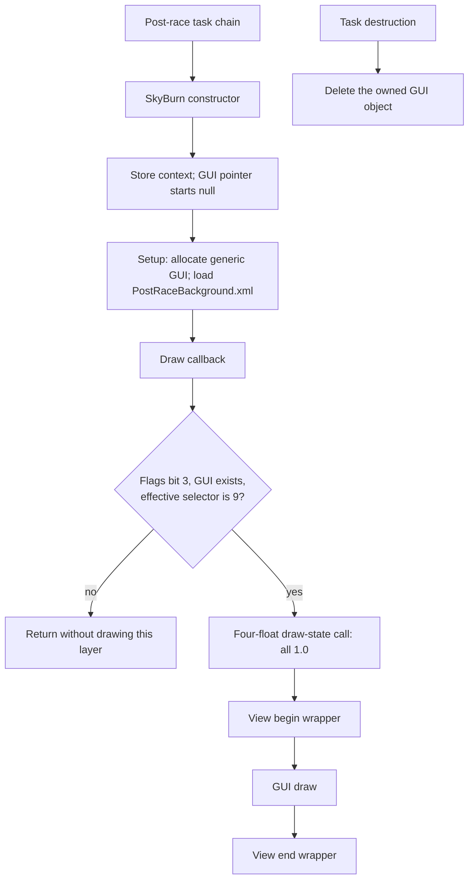

# Normal post-race background control and resource flow

Tracking: [black backgrounds #13](https://github.com/Indegosblade/RR3-DevOps/issues/13) and [optional asset coverage #15](https://github.com/Indegosblade/RR3-DevOps/issues/15). This continues the [visual asset audit](VISUAL_ASSET_FINDINGS.md) with a specific background's control flow. It is a static trace plus execution of the original ARM64 draw callback in an emulator. No device, game/cache mutation or visual fix is claimed.

## The normal background is owned by `SkyBurn`

The retained `7SkyBurn` C++ RTTI resolves the vtable at `0x102BABAE8`. Its setup function has the only adjacent `ADRP`/`ADD` reference found for `PostRaceBackground.xml`. It creates a generic GUI object and loads the local layout. Fifteen direct `BL` callers create this task within post-race task chains.



For the researched executable UUID `06ed5b50c44c3b69a5840701b8a88451`:

| Site | Observation |
|---|---|
| `0x1003D2610` | Constructor stores context at task `+0x08`; GUI pointer `+0x10` and predicate byte `+0x18` start zero |
| `0x1003D26C0` | Setup allocates `0x220` bytes, calls generic GUI constructor `0x1004FE48C`, stores GUI pointer |
| `0x1003D26E8` | Loads the `PostRaceBackground.xml` filename; setup tail-calls loader `0x100536FF0` |
| `0x1003D2708` | Draw callback first requires callback-flags bit 3 and a non-null GUI pointer |
| `0x1003D2714` | Reads context selector at `+0x698`; when it is `-1`, uses `+0x690`; requires effective value `9` |
| `0x1003D2738` | Loads global interface `0x103255E30`; calls virtual slot `+0x80` with four `1.0` floats |
| `0x1003D276C` | Calls view wrapper `0x10070DD40`, then GUI draw `0x10050127C`, then tail-calls view wrapper `0x10070DD68` |
| `0x1003D2628` | Destructor deletes a non-null owned GUI object through its virtual destructor |

The four-float call resembles white tint/draw-state setup, but its source-level method name is not established here. Selector `9` and callback bit `3` are left as numeric conditions rather than assigned guessed enum names. The task's separate byte predicate and the scheduler's lifetime/activation semantics are not inferred just from its vtable slot.

### What this does and does not say about dead services

The local callback does not read an online-response or request-pending flag. Its immediate control inputs are callback flags, the created GUI pointer and the context selector. That is evidence against treating this particular layer as a direct network-response waiter.

It does **not** rule out a higher-level pending operation preventing the expected context/transition, a loader failure, a virtual interface side effect or a renderer/underlying scene problem. The tracer does not bypass those dependencies. Forcing the draw gate or changing the blend mode could draw at the wrong phase and is not justified by this trace.

The layout uses `rewards/post_race_sky_burn.png` with `Translucent Color Multiply`, fully opaque white component color, and a stretched/best-fit transform. Its sprite exists in all three GUI families. The available referenced texture streams passed the earlier full-stream audit. Neither the XML nor this callback names the missing promotional movie.

## Unresolved image references are not one kind of failure

`trace_background_resources.py` classifies the prior audit's 658 unresolved static references. The categories describe evidence and have an explicit `automatic_replacement_justified=false`; they are not counts of broken active screens.

| Category | References | Interpretation |
|---|---:|---|
| Absent manifest collection candidates | 351 | Collection prefix matches an absent declared HD atlas; no proof of the absent atlas's precise contents or current event use |
| Prototype-named `R4/` namespace | 28 | Prototype-like naming; actual runtime eligibility is unproven |
| Car-sale references with available runtime candidates | 18 | Existing versioned/accelerator images match the same car ID and executable path-construction templates |
| Remaining placeholder-named references | 5 | Placeholder naming alone does not prove successful runtime assignment |
| Other unresolved binding/content | 256 | No supported static resolution established |

These are mutually exclusive categories in the listed classifier's priority order. A placeholder inside an absent declared collection is counted with that collection, not counted twice. Separately, **80 unique explicitly editor-only image names** are excluded from the audit's runtime-reference inventory. Some may also appear in other non-editor uses.

### Correct existing car-sale paths, not replacement art

The executable constructs and tries:

```text
car_sales/cars/build_[0]/car_sales_car_[1].png
car_sales/cars/accelerator_cars/car_sales_car_[0].png
```

The versioned template is loaded at `0x10071CF80` and formatted with values from the relevant car metadata and car ID. The accelerator template is loaded at `0x10071CFC0`. Candidate lookups at `0x10071D040`, `0x10071D07C` and `0x10071D08C` return early on success. On failure, a `Missing car image` message is logged and the code loads `car_sales/cars/car_sales_car_generic_silhoutte.png` at `0x10071D0FC`. That fallback sprite exists in all three GUI families.

For example, static reference `car_sales/cars/car_sales_car_174.png` has an existing `car_sales/cars/build_310/car_sales_car_174.png` candidate. This is consistent with the executable's versioned path mechanism. It does not establish which build metadata is selected at runtime, so the tool reports the existing candidate rather than rewriting the layout.

Of all 658 unresolved references, **120** have a same-basename sprite elsewhere. **93** are in other limited-time-series collections, often shared filenames such as `lts_bg.png` representing different event artwork. They are **not** valid automatic substitutions. There were **zero** case-only sprite matches among these unresolved references and no established exact-path alternate-family resolution.

## Reproduce and validate

```text
python scripts/trace_background_resources.py --input final-build.ipa --cache Caches_ipastore.zip --output background-flow.json
python -m unittest discover -s tests -p test_background_resources.py -v
```

The tracer checks the executable UUID, four exact instruction-region hashes, expected resource strings and `SkyBurn` RTTI before reporting code-specific findings. Adjacent `ADRP`/`ADD` and direct `BL` scans are deliberately narrower than a whole-program data-flow proof; computed addresses, non-adjacent register flow and indirect callers can remain outside them.

Tests execute the original 132-byte ARM64 callback in Unicorn, mocking external draw interfaces. They check suppressed cases (flags, absent GUI, mismatched selector), accepted default/override cases, call order, object arguments and the four `1.0` float arguments. Other tests cover instruction-address decoding, changed-code/UUID refusal and refusal to treat same-basename event art as a justified replacement. This is control-flow validation, not pixel rendering.

The next useful runtime observation is the exact affected screen together with: whether `SkyBurn` was created/setup; loader success and selected atlas/page; callback bit 3; GUI pointer; both selector fields; whether the draw callback runs; and the underlying view/renderer state. No targeted behavioral patch is justified until one of those conditions is shown to fail where the layer should be visible.
