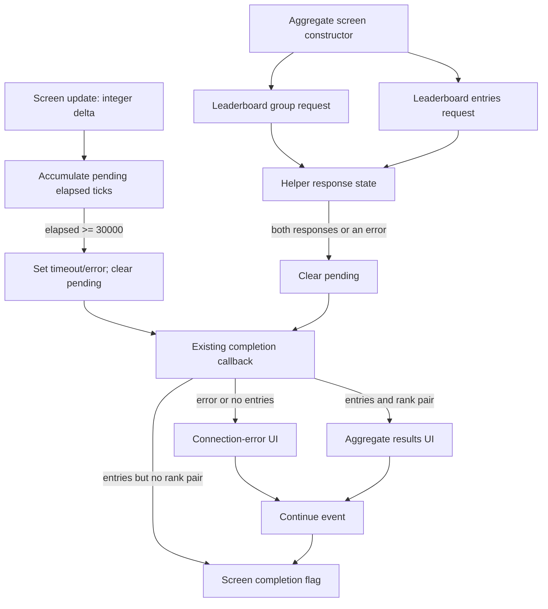

# Time Trial post-race completion and experimental timeout candidate

Tracking: [issue #14](https://github.com/Indegosblade/RR3-DevOps/issues/14).

This is a static trace of the researched final executable, followed by execution of one guarded leaf routine in an ARM64 emulator. No device was connected. No released builder, IPA, cache or save was changed. The candidate described below is **experimental and has not been device-validated**.

## A finite wait, not a demonstrated infinite loop

`TTCPostRaceTask` creates `TimeTrialTournamentAggregateScreen`. Its completion predicate reads the screen's byte at `+0x264`. One producer is a normal `BTN_CONTINUE` event, so forcing that byte true would bypass expected UI behavior.

The aggregate screen owns a leaderboard helper at `+0x298`. That helper starts two different requests, combines their responses, and already has a bounded timeout:



**30,000 is an integer update-unit count.** The screen forwards its integer update argument directly to this timer. This audit does not establish the real-time duration of those units; it must not be presented as a measured 30-second delay.

No runtime trace establishes that this is the screen delayed in the community report. Tournament aggregate results and ordinary/local Time Trial results remain separate paths.

## Exact-build evidence

All addresses are unslid virtual addresses for UUID `06ed5b50c44c3b69a5840701b8a88451`.

| Component | Site | Observation |
|---|---|---|
| Aggregate task creation | `0x1003E709C` | Allocates the screen; stores it at task `+0x10` |
| Aggregate task completion | `0x1003E7088` | Returns screen byte `+0x264` when a screen exists |
| Aggregate screen constructor | `0x1003E4F5C` | Initializes completion/state, constructs helper, binds callback `0x1003E6F78` |
| Request launch | `0x1001561FC` | Starts group and entries requests; pending/response/error/elapsed state initialized at `0x1001564E0` |
| Group request | `0x100154DA8` | `CC_Helpers::LeaderBoardGroupSync`, vtable `0x102B60970`, response `0x100156560` |
| Entries request | `0x100153724` | `CC_Helpers::LeaderBoardSync`, vtable `0x102B60900`, response `0x100156660` |
| Shared request bridge | `0x1001654EC` | Serializes an operation through a virtual request-manager interface and stores its returned request ID |
| Aggregate screen update | `0x1003E5ED4` | Passes update delta to timer; direct call at `0x1003E5EF4` |
| Timer | `0x1001567B4` | Accumulates `+0x108` while pending `+0xFC` and not errored `+0x106` |
| Timer threshold | `0x1001567D4` | `mov w9, #0x7530` (30,000) |
| Normal timeout | `0x1001567E0` | Sets error, clears pending, invokes existing closure if present |
| Aggregate callback | `0x1003E6F78` | Chooses connection-error UI, aggregate result UI, or no-rank completion |
| Continue handler | `0x1003E6E58` | Event type 1 and `BTN_CONTINUE` set completion at `0x1003E6EE0` |
| Screen/helper cleanup | `0x1003E5150` / `0x100156020` | Calls request abandonment and clears/deletes handles |
| Request abandonment | `0x100165494` | Passes a nonzero request ID to the manager's abandonment slot before deleting the request object |

The timer has one direct `BL` caller in this executable. Direct-call scanning cannot prove the absence of computed or indirect calls.

## Helper state and callback ownership

| Helper offset | Meaning supported by the traced accesses |
|---|---|
| `+0x00`, `+0x08` | Outstanding group/entries request handles |
| `+0x28` | Completion closure |
| `+0xFC` | Pending state |
| `+0x104`, `+0x105` | Response-received flags for the two requests |
| `+0x106` | Error/timeout state |
| `+0x108` | Accumulated integer update delta |

Each response handler marks its own response received. A missing/error response marks the error field. The helper invokes its closure once when both responses have arrived or an error is available, and clears pending before invoking it. The timer uses the same pending-clear/one-shot mechanism.

The timer does **not** directly write the task's `+0x264` completion field. In the error case, the aggregate callback adjusts the connection-error UI; the user's Continue event can then finish the task. Successful ranked data follows the existing results-building path. A populated response without the expected rank pair has a separate completion path.

The decrypted `gui/processed/TimeTrialTournamentAggregateScreen.gui` agrees with the code's numeric IDs:

| ID | Element | Relevant content |
|---|---|---|
| `19999` | `BTN_CONTINUE` | Normal Continue interaction |
| `1372742069` (`0x51D261B5`) | `FRAME_SYNCING` | Container for pending/error state |
| `1372742071` (`0x51D261B7`) | `SYNCING_TEXT` | `GAMETEXT_TIME_TRIAL_TOURNAMENT_RETRIEVING_SCHEDULE` |
| `1372742072` (`0x51D261B8`) | `SYNCING_ERROR` | `GAMETEXT_ERROR_INTERWEB_CONNECTION_FAIL` |
| `1373327264` (`0x51DB4FA0`) | `AGGREGATE_INFO_FRAME` | Results content |

GUI decoding uses the existing `eds_crypt()` transformation in memory; no decoded layouts are added to source.

[Request-delivery analysis](REQUEST_DELIVERY_FLOW.md) shows that normal completion is update-drained but ManagerV34 can synchronously reject a server-listed operation. The helper arms/resets its pending state after starting both handles; original helper probes lose early error state when that reset executes. This is a separate path from the cached synchronous `LeaderBoardSync::Start` branch, which this constructor avoids with a negative cache key.

The [lifetime probe](INLINE_REJECTION_FLOW.md) also shows deletion before the bridge's late ID store and provides a limited experimental guard for initially-zero request IDs. Neither observation establishes actual rejection-set contents or the cause of the reported delay. A full helper repair must also preserve construction reentrancy and callback ownership; neither the timeout experiment nor the fresh-ID guard fixes that state machine.

## Ordinary/local leaderboard boundary

`LeaderboardTask` and `LocalLeaderboardTask` have separate setup paths (`0x1003D1718` and `0x1003D1420`) and share completion predicate `0x1003D1704`, reading pointed-object byte `+0x471`. Their result-screen constructor is `0x1003D0058`.

These paths are not replaced by the tournament timeout candidate. A local path existing in the binary is not proof it can safely replace remote results. No local-save transaction or save/write ordering was established in this trace, and nothing here bypasses persistence.

## Experimental timeout-shortening plan

`scripts/trace_postrace.py` exposes `patch_timeout(binary, timeout_ticks)`, which changes **one four-byte instruction**: the timeout immediate at file offset `0x1567D4`. All other bytes remain identical. It refuses an unknown UUID, changed 80-byte timer function, changed known caller, booleans/non-integers and values outside `1..29999`.

The expected complete timer-function SHA-256 is `36a0ed5712d0a805fa1cce2db7951b47948d6df5a89186b3bb6007710f5de7ed`. The 1,000-tick example is an experiment parameter, not a recommended production default.

```text
python scripts/trace_postrace.py --input release-dist/RR3-DevOps-v1.1-Production-Quality.ipa
python scripts/trace_postrace.py --input release-dist/RR3-DevOps-v1.1-Production-Quality.ipa --experimental-timeout-ticks 1000 --candidate-output investigation/postrace-timeout-plan.json
python -m unittest discover -s tests -p test_postrace_trace.py -v
```

The CLI writes a patch-plan JSON only when explicitly requested. It does not write a modified executable/IPA, sign anything, or alter the production builder. Any packaged candidate would need proper re-signing.

This candidate is defensible as a controlled way to test whether the pending interval contributes to the observed delay. It preserves the game's existing error UI and completion callback, instead of pretending a request succeeded or forcing a screen complete. It can also reject a genuinely slow response sooner. It does not remove outstanding network requests at the instant of timeout; normal screen/helper cleanup retains that responsibility.

Five local tests passed. The ARM64 emulator executes the original leaf instructions and the candidate, checking inactive/already-completed/error states, below-threshold accumulation, original/candidate expiry, callback argument and state, a missing closure, and prevention of repeat callbacks. Separate tests check the exact-build guards and that bytes outside the one instruction remain unchanged.

Before promotion: identify the affected result screen, measure elapsed units and request outcomes, verify error/Continue behavior and successful-data behavior, complete a race and cold offline restart, and verify save/cache continuity. No runtime benefit, Time Trial fix, CPU/disk improvement or save safety is claimed from emulation alone.
