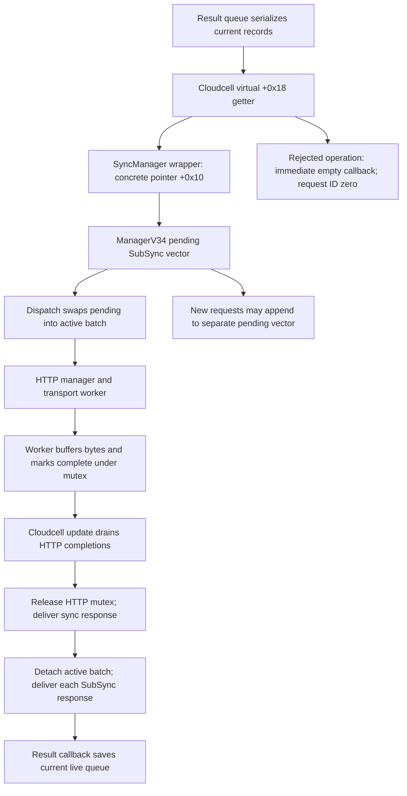

# Cloudcell request delivery and result-queue ownership

Tracking: [issue #14](https://github.com/Indegosblade/RR3-DevOps/issues/14). This extends [ordinary post-race persistence](ORDINARY_POSTRACE_FLOW.md) and the [tournament helper trace](POSTRACE_CONTROL_FLOW.md).

The lower boundary is now identified: ordinary requests pass through a **sync batching manager**, then an HTTP manager. Transport completion records state; Cloudcell's update path drains completed HTTP requests and invokes the game callback. There is also a conditional synchronous rejection path, so callbacks cannot universally be assumed deferred.

All addresses are unslid VAs for executable UUID `06ed5b50c44c3b69a5840701b8a88451`. Evidence consists of exact-build instructions, retained C++ RTTI/vtables, and controlled execution of original ARM64 windows with synthetic data. No device, network service, user save, signing material, released IPA or builder was modified. No runtime delay, CPU cost, write latency or complete save-safety claim follows from this trace.

## The missing virtual interface



| Layer | Concrete evidence |
|---|---|
| `cc::Cloudcell` | Vtable `0x102C5E038`; `+0x18` targets getter `0x1016D2300`, which returns object member `+0x1C8` |
| `cc::sync::SyncManager` wrapper | Vtable `0x102C60B80`; installed at Cloudcell `+0x1C8` by `0x1016D0A04`; submission `0x1016FD468` and abandonment `0x1016FD498` forward through wrapper member `+0x10` |
| Concrete `cc::sync::ManagerV34` | Vtable `0x102C61E10`; factory `0x1016FD2D0` accepts protocol `0x22` (34), allocates `0xE8` bytes and constructs it through `0x10170B444`; another protocol takes an assertion/null branch |
| Sync submission / dispatch / abandon | Virtual slots `+0x10`, `+0x20`, `+0x28` target `0x10170B62C`, `0x10170B7A0`, `0x10170BEE4` |
| `cc::HttpRequestManager` | Vtable `0x102C64B98`; separate Cloudcell member `+0x1D0`, installed at `0x1016D0A18`; submit `+0x18` targets `0x101731C54`; drain `+0x78` targets `0x101732868` |

The result-vector serializer `0x1003E8450` submits operation word `0x28D3` and second word `0x1345`. It builds the payload before virtual submission. The callback closure still captures the queue object; a payload snapshot does not freeze that object's later contents.

## Pending, active, and detached batches are different owners

`ManagerV34` uses a byte lock at `+0x10`, acquired with ARM64 exclusive atomics in `0x10170CE20` and released with `STLRB`. It owns two vector triples:

| Manager offset | Role |
|---|---|
| `+0x18 / +0x20 / +0x28` | Pending vector begin/end/capacity |
| `+0x30 / +0x38 / +0x40` | Active vector begin/end/capacity |
| `+0x48` | Operation rejection set; separate from the vectors |
| `+0xA8` | Current batch's HTTP request ID |

A SubSync is `0x50` bytes. Construction at `0x10172516C` copies its blob, stores operation words at `+0x18/+0x1C`, assigns an incremented ID at `+0x20`, takes the response closure at `+0x28` (target pointer `+0x40`), and clears delivered/abandoned bytes `+0x48/+0x49`.

Dispatch at `0x10170B7A0` checks subsystem/authentication readiness, active-vector emptiness, pending-vector nonemptiness, and zero HTTP ID. At `0x10170B888..0x10170B898` it swaps pending and active vector storage, then serializes the active records and starts one HTTP request. This is batch ownership, rather than one transport request for every result record.

Submission at `0x10170B62C` can append to the pending vector while another batch is active. An original-instruction probe supplied one active SubSync and HTTP ID 77; a new accepted submission added one pending record, returned ID 1, left the active record and HTTP ID intact, and invoked no inline callback.

The response handler `0x10170C07C` takes the manager lock, moves the active vector into a local vector at `0x10170C0CC..0x10170C104`, clears the manager's active vector, and releases the lock **before** delivering per-record callbacks. After processing it clears the HTTP ID and invokes dispatch for whatever is pending next.

These locks protect the manager's records. They do not prove the game-level `rres.bin` RAM vector is immutable while an HTTP batch is pending. The serializer and reply callback act on different representations: serialized bytes owned by SubSync, and the current live game queue captured by the closure. Actual game/UI sequencing that would prevent a new result enqueue throughout that interval has not been established.

## Transport completion and game callback delivery are separate

The transport-facing callbacks do not directly call the result queue:

- `0x101732B44` appends received bytes to the HTTP request's buffer under the HTTP mutex.
- `0x101732C44` marks request byte `+0xC8` complete under that mutex.
- Cloudcell update `0x1016D1D4C` calls the HTTP drain through virtual slot `+0x78` at `0x1016D1D6C`.
- Drain `0x101732868` checks completion and already-delivered byte `+0xC9`, sets `+0xC9` before delivery, releases the HTTP mutex at `0x101732910`, and delivers the completion closure through `0x101732A58`. It then reacquires the mutex, removes the request and destroys it.

In a controlled original-instruction probe, an incomplete request survived two drains without a callback. A completed request invoked its closure once with HTTP ID 77 and four buffered bytes, while the simulated HTTP mutex was released; the second drain added no callback. A completed request with its closure detached retired without a callback.

This establishes the normal completion callback's **Cloudcell-update caller context**, rather than transport-completion context. Cloudcell update is virtual slot `+0x120`; it can also be pumped by caller `0x1001483C4` in a separate flag/counter-controlled routine. It does not establish the OS thread ID, prove this is always the main thread, or validate arbitrary concurrent callers of update/cancel. The mutex APIs are hooks in the probe; it checks the original acquire/release call sequence, not a real multi-threaded schedule. HTTP streaming delivery is a different path in the drain; the completed-response probe does not establish that every HTTP callback runs outside the mutex.

## Abandonment suppresses a callback, not the shared transport

`0x10170BEE4` searches the pending and active vectors by SubSync ID. A match sets abandoned byte `+0x49`, clears the stored callback target, and destroys that closure. It does not remove that SubSync, clear the shared HTTP ID or invoke HTTP cancellation.

Per-record delivery at `0x101725268` consumes the corresponding response data, skips the callback for an abandoned record, and marks delivery complete. The HTTP request can still finish for the other members of the batch.

Original-instruction cancellation probes cover both vectors and an unknown ID: a matching cancellation detaches the closure once and leaves HTTP ID 77 intact; an unknown ID leaves the record unchanged. This is **not a general cross-thread cancellation guarantee**. Once the response handler has detached the active vector into local storage, the manager's ID search cannot find those local records. A caller that relies on abandonment synchronizing with an already-running callback still needs an external ownership/thread rule.

## Failure advances the queue; it does not requeue the failed batch here

The sync response handler treats an empty/failed response through `0x10170C1E4`. For each detached active record it constructs an empty blob and invokes the normal SubSync completion path. It then clears `+0xA8`, dispatches the existing pending vector and disposes of the detached active vector.

An original-instruction probe ran this handler and the SubSync callback with one old active record and one separate pending record. The old record received one empty completion and became delivered; the active manager vector remained empty; the pending vector retained exactly its original one record. The next-dispatch hook saw HTTP ID zero and that same pending count. No copy of the failed record was requeued by this response path.

There is no failed-record backoff counter or automatic requeue in this traced path. This finding does not rule out retry/redirect behavior inside the platform transport, a fresh screen-entry flush, higher-level retry UI, or other event-driven dispatch. It does not establish an actual offline retry rate. The game's empty result callback still performs the previously traced save/unload behavior.

## The synchronous rejection exception and tournament sequencing

Submission first looks up its operation word in the set at manager `+0x48`. If present, `0x10170B678..0x10170B6C8` creates an empty response, invokes the supplied closure immediately while holding the sync lock, returns ID zero and adds no pending record. An exact original-instruction probe demonstrates that conditional behavior.

The constructor initially zeros the set. Successful response parsing can clear/populate it at `0x10170C2B0..0x10170C320`. No captured server response or local configuration in this work proves the set ever contains the ordinary upload operation `0x28D3` or the tournament operations below. Being offline is not the lookup condition. The probe controls the set-lookup result and must not be presented as observed server policy.

Tournament helper construction uses group operation `0x28F4` and entries operation `0x28ED`. In `0x1001561FC`, pending is cleared before starting the handles. Group starts at `0x1001563D4`, entries starts at `0x1001564DC`, and **after both return** the block `0x1001564E0..0x10015650C` sets pending and clears both response flags/error/elapsed state.

The helper's empty group callback `0x100156560` and empty entries callback `0x100156660` each clear their handle and set received/error state. They invoke the helper closure only when pending is already true. Supplying either or both empty callbacks while pending is zero therefore records an error without calling the closure; the later original arm block erases that state and sets pending true. Original-instruction probes reproduce all three cases. Under that hypothetical schedule, the helper can wait for its existing timeout despite having received an early error.

This is a conditional sequencing hazard, separate from the cached synchronous `LeaderBoardSync` path avoided by the constructor's negative cache key. Its real rejection-set reachability is unknown. No helper-arm relocation or other patch is proposed: arming earlier would also permit callback delivery during construction and change ownership/reentrancy behavior that has not been validated.

## Reproduction and limits

```text
python scripts/trace_request_delivery.py --input release-dist/RR3-DevOps-v1.1-Production-Quality.ipa --emulate
python -m unittest discover -s tests -p test_request_delivery.py -v
```

The tracer validates UUID, 21 complete or explicitly bounded instruction windows, retained type names, and the relevant vtable slots. Its optional JSON output refuses overwrite. The tests embed 6,408 original instruction bytes plus synthetic Mach-O metadata and objects; they require no IPA or private files. Thirteen tests pass, including changed-window/UUID/vtable refusals, pending-during-flight admission, conditional inline rejection, cancellation, deferred HTTP delivery, failed-batch retirement and early-helper-state loss. Opaque locks, blob APIs, logging, allocation cleanup and selected next-layer calls are controlled hooks.

No behavioral candidate is emitted. A write-elision change still lacks a durable generation/dirty-state invariant. A successful payload snapshot cannot justify unloading newer RAM entries after a failed initial write. A callback-thread inference cannot substitute for game-level enqueue and acknowledgement ordering. Useful next runtime evidence is the active task, callback/update thread IDs, pending/live queue generations, submitted record IDs, HTTP outcomes and file-open/finalization outcomes, using synthetic or explicitly authorized test saves.

The separate [inline rejection lifetime follow-up](INLINE_REJECTION_FLOW.md) now executes the whole helper/bridge/response/destructor path. It demonstrates a conditional post-deletion field store and prepares an isolated fresh-ID store guard. That experiment is distinct from this read-only delivery tracer and does not remove queue writes, change callback order or fix helper arming. Its narrower scope and still-unverified server-policy/platform conditions are explicit.
