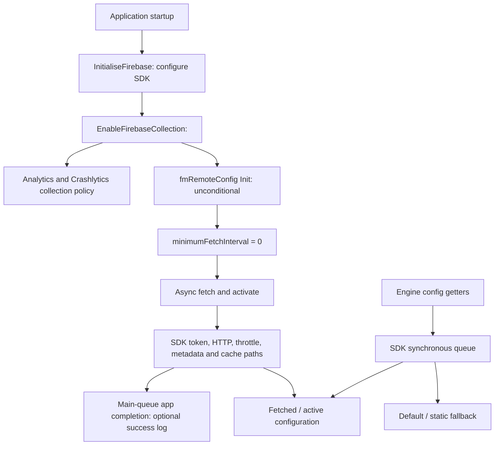

# Live SDK lifecycle: Remote Config startup fetch

This investigation follows one concrete operation that survives the production
ad-readiness suppression: the game's Firebase Remote Config initialization and
fetch. It extends the [dependency inventory](SDK_DEPENDENCY_AUDIT.md). It does
not establish that this request causes the reported black backgrounds or Time
Trial delay, and it does not apply a behavioral patch.

`scripts/trace_sdk_lifecycle.py` checks the researched executable UUID, hashes
the relevant instruction windows, resolves Objective-C methods/selectors and
indirect Mach-O symbols, and reports the observed boundaries. Optional Unicorn
execution compares original control flow with a narrowly scoped experimental
return in emulated memory. Input IPA/cache bytes, signing and devices remain
untouched.

```text
python scripts/trace_sdk_lifecycle.py original.ipa
python scripts/trace_sdk_lifecycle.py original.ipa --emulate
python -m unittest discover -s tests -p test_sdk_lifecycle.py -v
```

Static tracing uses Python 3.12 and the standard library. `--emulate` and the
regression tests require `unicorn==2.1.4`. An optional `--output report.json`
creates a new report; existing files and the input IPA cannot be overwritten.

## Concrete startup flow



All addresses below are unslid virtual addresses in executable UUID
`06ed5b50c44c3b69a5840701b8a88451`; they are not portable patch locations for
another build.

| Boundary | Address | Evidence |
|---|---|---|
| Collection policy producer | `0x10092d950` onward | Global `0x103255dd0`; nil gives false, otherwise a virtual call at vtable offset `0x90` supplies the Boolean |
| Collection policy receiver | `0x10092d9d8` | `-[RealRacingAppDelegate EnableFirebaseCollection:]`, type `v20@0:8B16` |
| Analytics policy call | `0x10092d9f0` | Forwards the input Boolean to `setAnalyticsCollectionEnabled:` |
| Remote Config initialization | `0x10092da00` | Calls `Init` on an allocated `fmRemoteConfig`, regardless of that Boolean |
| Game Remote Config initializer | `0x100820094` | Sets minimum interval, installs settings and dispatches the fetch |
| Explicit minimum-interval override | `0x1008200b4` | `d0 = 0.0` passed to `setMinimumFetchInterval:` |
| Game-owned fetch wrapper | `0x1008200ec` | `+[fmRemoteConfig FetchAndActivateRemoteConfig]`, type `v16@0:8` |
| SDK fetch dispatch | `0x10082010c` | Tail branch to `fetchAndActivateWithCompletionHandler:` |
| App completion block | `0x100820110` | Global block, 32-byte header and no captured application state |

The underlying engine virtual method that produces the collection flag has not
been identified. It must not be renamed to a particular consent/privacy setting
without further evidence. The false case is nevertheless clear: turning off
that Boolean does not skip Remote Config initialization. Emulation of the real
prefix confirms that both input values reach `Init`.

There is also a native forwarding thunk at `0x100931308` that obtains the app
delegate and forwards its Boolean to this receiver. It can cause another
initialization when invoked. This investigation has not shown that a foreground
transition, an ad or a Time Trial specifically invokes that thunk. Direct
selector scanning finds one call from the initializer to the game fetch wrapper;
it does not constitute a complete dynamic call graph.

## Request, failure, timeout and cancellation ownership

The compiled `FIRRemoteConfigSettings` constructor contains a **43,200-second**
default minimum fetch interval and **60-second** fetch timeout. The game
overrides the minimum interval to **zero**, while leaving the observed timeout
default in place. This permits a new backend fetch when this initializer runs;
it does not disable the SDK's concurrent-fetch or throttling checks and does
not establish a busy loop.

The request pipeline is SDK-owned:

| Stage | Address | Relevant semantics |
|---|---|---|
| Async fetch entry | `0x101ed9f58` | Resolves to imported `_dispatch_async` |
| Async fetch operation | `0x101ee55e4` | Also uses `_dispatch_async` on the SDK path |
| Fetch gates | `0x101ee5668`, `0x101ee567c`, `0x101ee56d4` | Check minimum interval, fetch in progress and throttling |
| Installations-token dependency | `0x101ee572c`, `0x101ee5d68` | Enters the normal Installations auth-token path; this is distinct from the previously documented development/stage-only forced-token call |
| Request/resource timeouts | `0x101ee7aa8`, `0x101ee7ab8` | Both receive the SDK fetch timeout |
| HTTP request creation/resume | `0x101ee7d88`, `0x101ee6d30` | Creates an `NSURLSession` data task and resumes it |
| Backoff path | `0x101ee746c` | HTTP 429, 500, 503 and 504 can enter exponential backoff with jitter |
| Config / metadata persistence | `0x101ee7648`, `0x101ee77e0` | Update fetched content and fetch metadata on the relevant result paths |
| SDK fetch-owner destruction | `0x101ee54cc` | Calls `invalidateAndCancel` |

Token/identifier failures clear fetch-in-progress state and report an SDK
completion error; success can proceed to HTTP fetch. HTTP/parse failures and
throttling have completion/error paths. Successful fetched data can be activated;
the SDK records corresponding metadata. These paths establish potential network
and local-storage work, not measured traffic, write frequency or latency on a
device.

The game wrapper returns `void`, stores no task handle and does not wait for its
completion. Firebase forwards the fetch-and-activate completion onto imported
`__dispatch_main_q`. Its app callback only logs status zero with a nil error;
cached-data status, nonzero status or an error return without that log. The
compiled callback has no game-state capture and no memory-writing instruction.
Six original-byte emulation cases confirm those local effects.

Consequently, the SDK's 60-second timeout is **not evidence of a 60-second
main-thread stall**. A separate synchronous getter boundary exists, as described
below, and would need its own trace/measurement if implicated in a reported wait.

Firebase's [public API contract](https://github.com/firebase/firebase-ios-sdk/blob/main/FirebaseRemoteConfig/Sources/Public/FirebaseRemoteConfig/FIRRemoteConfig.h)
also describes fetch/activation, cached configuration and Installations-token
use. That current source is corroboration of the API model, not proof of the
exact SDK version embedded in this executable or of backend availability. EA's
shutdown alone does not establish that every third-party SDK service is down.

## Configuration consumers must remain intact

The game exposes integer, string and Boolean getters through C++ bridges at
`0x1001e3f40`, `0x1001e3fe4` and `0x1001e4084`. They forward caller-supplied
`std::string` keys to `fmRemoteConfig` and return its typed values. The wrappers
call the SDK's `configValueForKey:` and convert the result with `numberValue` /
`intValue`, `stringValue` / `UTF8String`, or `boolValue`.

The SDK getter uses `_dispatch_sync` at `0x101edacf8`, reads active configuration,
and falls back to default/static values when no active value is available. This
investigation does not resolve every engine/script key or its gameplay meaning.
The log-only fetch completion therefore does not prove that configuration data
is unused. Initialization, cached/default state, getter ABI and SDK queue/data
ownership must be retained.

No game-owned wait/retry loop or game-owned cancellation handle was found in
the small fetch wrapper. That observation does not rule out SDK-owned work,
indirect callers, listener effects, database-initialization waits or repeated
collection-policy forwarding elsewhere.

## Bounded experimental boundary, not a release fix

The read-only report describes one possible experiment at file offset
`0x82010c`: replace the wrapper's final branch (`cd2b6a14`) with an ARM64 return
(`c0035fd6`). Its normal epilogue has already restored the caller's frame. This
would skip only the game-owned fire-and-forget fetch dispatch, while keeping
Firebase initialization, the Remote Config singleton/settings and typed getters.
No real input or release artifact is modified by the tracer.

Original-byte Unicorn execution verifies that the original forwards the global
completion block to the mocked SDK, and that the hypothetical return restores
the same caller stack/frame pointer and callee-saved register while omitting
that dispatch. Synthetic regression fixtures exercise these contracts without
distributing game executable bytes.

This is **not release-ready**. It freezes this path's fresh activation while
retaining whatever active/default state exists; the complete set of gameplay
consumers is unresolved. Other SDK initialization or background work can remain.
There is no demonstrated connection to a particular black screen, Time Trial
delay or CPU/disk report. The emulated SDK calls are mocks, not network, UI or
gameplay validation.

The follow-up [consumer and cache trace](REMOTE_CONFIG_CONSUMERS.md) identifies
32 direct calls covering 22 keys, including frame-rate and unlock policy, and
the SDK's separate nominal 30-second initial local-database wait. Suppressing
fetch retains that local wait and can leave fresh and existing installations
with different active/default values. Complete dynamic/script coverage and
runtime effects remain unresolved.

Acceptance requires separate-copy checks for cold start with and without prior
configuration, config-dependent menus/events, the reported operation, race
completion, offline restart and save continuity, plus timing/network/storage
observations that show the intended work was actually removed. No connected
device run or suppression patch is claimed by this change.

## Time Trial interstitial task: checked separately

The Time Trial end-race sequence constructs `DisplayInterstitialTask` at
`0x1004d7804` and `0x1004d792c`. The tracer verifies both constructor calls
and the task's RTTI. This is a more direct ad/UI boundary than Remote Config,
but its presence in the sequence is not itself evidence of a hang.

| Boundary | Address | Observed ownership/control flow |
|---|---|---|
| Task start | `0x1003cbafc` | Checks a manager helper for the prior placement; if false, forwards the requested placement to `ShowInterstitial` |
| Manager show request | `0x10066d448` | Has eligibility, feature and placement checks before obtaining a `GuiAdvertisement` |
| GUI ad creation/no fill | `0x10066d7e0` | A failed provider fill deletes the new GUI-ad object and returns null |
| Modal creation boundary | `0x10066d5b0` | Null GUI-ad input exits before allocating/scheduling a modal |
| Modal scheduling / latch set | `0x10066d670`, `0x10066d698` | Schedules the modal, then sets manager byte `+0x1b4` |
| Modal-close callback | `0x10066db6c` | Clears manager byte `+0x1b4` |
| Task poll | `0x1003cbb9c` | Requires a clear manager latch and bit zero of a separate game-state byte |
| Task cleanup | `0x1003cbb44` | Contains additional state-dependent cleanup; it must not be bypassed casually |

The modal's RTTI names `FrontEnd2::InterstitialAdPopup`; its constructor uses
logical resource `InterstitialAdPopup.xml` and `CONTENT_FRAME`. A logical XML
resource name does not prove that an XML file should exist literally in the IPA;
the engine has compiled GUI resources. No missing layout or black image was
established by this trace.

The poll reads the manager at global `0x103251f08` and game object at global
`0x103251e60`. Its exact predicate is:

```text
task_done = !(manager.byte_0x1b4 & 1) && (game.byte_0x141 & 1)
```

The meaning and all later writers of the game-state bit at `+0x141` remain
unresolved. The follow-up [ad-state ownership trace](AD_STATE_OWNERSHIP.md)
identifies its initializer: a little-endian halfword store initializes this
byte to one. It must not be forced true or described as a confirmed
fade-complete flag.
Original-byte emulation covers all four valid Boolean combinations, the start
helper's two outcomes, null/no-fill modal input with both existing latch states,
and the close callback. The no-fill path does not arm the latch, does not clear
an unrelated existing latch and restores its caller stack. The close callback
clears the ad latch. Thus a false ad-ready result alone does not demonstrate a
stranded ad-pending wait.

The manager has a PCSP virtual provider and a placement fallback flag at
`+0x22`. This investigation has not linked every provider's virtual readiness
method to the four patched Objective-C selectors. A non-null creative whose
provider later fails to deliver a close/error transition remains a separate
case; the complete provider-to-modal error/cancel route has not been proven.
An actually displayed modal also needs normal cleanup ownership preserved.

No unconditional task-complete, latch-clear, fade bypass or readiness patch is
proposed. Further work should identify the game-state bit's later writers and
an actual provider/error path that leaves a scheduled modal pending, then
reproduce that transition. The ad-state follow-up proves the normal button-close
route, not every provider failure route. With no affected screen or device trace, treating this task as
the cause of the accepted black backgrounds would exceed the evidence.
